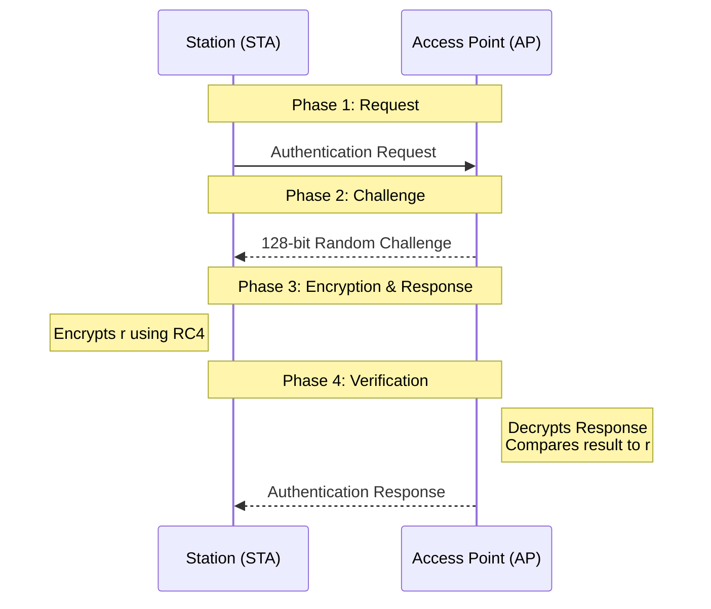

## The attacker model for WLANs
Before examining any specific security protocol for wireless networks, it is important to establish what an attacker can realistically do in the wireless environment. The threat model for WLANs assumes three fundamental attacker capabilities. 
- First, **passive sniffing** is always possible: because wireless signals propagate through open air, any nearby device with a wireless adapter can capture all frames transmitted within range, without sending a single packet or in any way revealing its presence. 
- Second, **active injection** is easy to achieve using commodity, off-the-shelf hardware, meaning an attacker can craft and transmit arbitrary frames into the network. 
- Third, and most importantly, **no physical access is required**: unlike wired networks, where an attacker must plug into a cable or gain access to a switch, wireless attacks can be carried out entirely from a distance.

This threat model has a direct implication: security mechanisms that rely on physical constraints or on the obscurity of network parameters are ineffective. Only strong cryptography provides a meaningful defense.

### Common (un)security measures
Several measures are sometimes mistakenly applied to restrict access to a WLAN. All of them are ineffective against the attacker model described above.

- **MAC address filtering** is one of the most commonly misunderstood measures. The idea is to configure the access point (AP) to only accept frames from devices whose MAC addresses are on an approved list. This provides no security because MAC addresses are transmitted in cleartext in every broadcast frame. A passive sniffer can trivially observe the MAC addresses of legitimate clients and then clone one of them, since MAC addresses can be freely set in software on commodity hardware.
- **Static IP address assignment** is equally ineffective. IP addresses are transmitted in cleartext in packet headers. A passive attacker can observe a valid IP address being used on the network and configure their own device to use it.
- **SSID hiding** (suppressing beacon frames so that the network name is not advertised) is also useless. Even if an AP is configured not to broadcast its SSID in beacon frames, the SSID still appears in cleartext in probe requests, probe responses, and association requests. Any passive sniffer captures it immediately as soon as a legitimate client connects.
- **Antenna placement** and **signal power reduction** are sometimes proposed as a way to limit the physical area in which the network is accessible. This fails because attackers are not constrained by the same hardware as the network operator. A determined attacker can use high-gain directional antennas to receive weak signals from a considerable distance. Furthermore, reducing signal strength degrades performance for legitimate users without providing any real security boundary.

The conclusion is that the only effective approach to WLAN security is the application of **serious cryptography**.

## WEP: overview and design goals
**Wired Equivalent Privacy (WEP)** is a set of security schemes introduced as part of the original IEEE 802.11 wireless networking standard, published in September 1997. As the name suggests, WEP was intended to provide wireless confidentiality roughly comparable to that of a traditional wired network. It was never designed to achieve strong or provably secure protection; rather, it was conceived as a pragmatic solution with modest, explicitly stated goals.

WEP was designed to address three security services:

- **Data confidentiality**, achieved through encryption using the RC4 stream cipher.
- **Access control**, achieved through a shared secret key used for authentication.
- **Data integrity**, achieved through a CRC-32 checksum appended to each frame, called the *Integrity Check Value* (ICV).

It is important to note what WEP does not provide:
- *Nonrepudiation* and *full digital signatures* are absent from the design.
- *Authentication* is provided only through possession of a shared secret, not through any public-key mechanism. 

The security architecture mapped onto WEP is therefore minimal: RC4 handles encryption and confidentiality, CRC handles integrity, and the shared secret key serves as the basis for access control.

The original WEP specification articulated five design properties it aimed to satisfy.

### WEP properties
- **Reasonably strong:** The security of WEP was intended to rest on the difficulty of recovering the shared secret key through brute force. Security increases with key length and with the frequency at which keys are changed. The designers acknowledged that statistical attacks could succeed if the keystream remained fixed over large amounts of ciphertext; WEP attempts to mitigate this by changing the *Initialization Vector* for each packet, and hence the RC4 keystream input, frequently.
- **Self-synchronizing:** WEP operates at the data-link layer, where packet loss and out-of-order delivery are normal. A security scheme that requires all prior packets to have been received correctly in order to decrypt the current one would be impractical. WEP addresses this by including the IV in each frame header, allowing the receiver to reinitialize RC4 independently for every packet without any shared state beyond the secret key.
- **Efficient:** RC4 is a stream cipher that requires very few computational resources compared to block ciphers. It can be implemented efficiently in both hardware and software, making it practical for the embedded devices of the time.
- **IP-free:** The WEP proposal was designed to avoid dependency on any intellectual property encumbrances.
- **Exportable:** The original specification noted the uncertainty around US export controls on cryptographic products and designed WEP with those constraints in mind.

## WEP access control
WEP requires a **STA** to authenticate with the **AP** before it can associate with the network. Two authentication methods are defined in the standard.

### Open System authentication
Open System authentication is essentially a null authentication mechanism. The STA sends an authentication request to the AP, and the AP responds with an authentication success. No cryptographic exchange takes place, no challenge is issued, and the shared key is not used at all during the authentication process. Any station that requests authentication is accepted. This mechanism provides no verification of identity whatsoever.

### Shared Key authentication
Shared Key authentication is based on a challenge-response protocol using the shared WEP key. The exchange proceeds as follows:

1. The STA sends an authentication request to the AP.
2. The AP responds with a 128-bit random challenge value `r` in cleartext.
3. The STA encrypts the challenge using RC4 with the shared key and an IV, producing $E_k(r)$, and sends the result along with the IV back to the AP.
4. The AP decrypts the response using the same key and IV, and if the result matches the original challenge, it sends an authentication success; otherwise it sends a failure.

Once successfully authenticated, the STA sends an association request and the AP responds with an association response, completing the process of joining the network. If authentication fails, no association is possible.

#### Shared Key authentication vulnerability
At first glance, Shared Key authentication appears more secure than Open System authentication, since the latter performs no verification at all. In practice, however, **Shared Key authentication is less secure than Open System authentication**, because it actively leaks keying material.

The reason is the structure of RC4, which is a stream cipher. In a stream cipher, encryption is performed by XORing the plaintext with a pseudorandom keystream: $E_k(r) = r \oplus K$, where $K$ is the RC4 keystream derived from the IV and the shared secret. A passive attacker who observes the authentication exchange sees both the plaintext challenge $r$ and the ciphertext $E_k(r)$. By XORing them together, the attacker directly recovers the keystream $K$:

$$K = r \oplus E_k(r)$$

The attacker now possesses the keystream used for that IV. They can use it to respond correctly to any future authentication challenge issued by the AP, simply by XORing the new challenge with the recovered keystream. This completely bypasses authentication without the attacker ever learning the underlying shared secret key.

Open System authentication, by contrast, involves no cryptographic exchange during authentication and therefore leaks nothing. While it offers no authentication, it does not worsen the overall security posture the way Shared Key authentication does.

#### Offline dictionary and brute-force attacks on Shared Key authentication

A second attack enabled by the Shared Key authentication exchange is an offline key recovery attack. In WEP, the "password" that users configure is the shared secret key itself. In practice, such keys are often short, human-chosen, and have low entropy. Because the attacker observes both the challenge $r$ (known plaintext) and the encrypted response $E_k(r)$ (ciphertext), they can test candidate keys offline without further interaction with the network. For each candidate key $k'$, the attacker computes the RC4 keystream $K' = RC4 \:(k', IV)$, encrypts the known challenge as $r \oplus K'$, and checks whether the result matches the observed ciphertext. A match confirms the correct key. This is a classic **known-plaintext attack** that reduces to a dictionary or brute-force search over the key space, which is feasible when keys are weak.

## WEP integrity and confidentiality

![[Pasted image 20260421094226.png]]
### Integrity: the CRC-32 checksum
WEP uses CRC-32 to provide data integrity. Before encryption, a 32-bit **Integrity Check Value** (ICV) is computed over the plaintext message using the CRC-32 algorithm and appended to the message. The combined payload (message concatenated with ICV) is then encrypted. On receipt, the receiver decrypts the payload and verifies that the CRC-32 of the decrypted message matches the ICV. A mismatch indicates corruption or tampering.

CRC-32 is entirely inadequate as an integrity mechanism for security purposes because it is not a cryptographic function.

### Confidentiality: RC4 encryption
WEP confidentiality is provided by the RC4 stream cipher, which is also used during authentication. RC4 is initialized with a seed consisting of the shared secret key concatenated with a 24-bit IV. For each message, RC4 produces a pseudorandom keystream, which is XORed with the plaintext (concatenated with its ICV) byte by byte. Decryption at the receiver is the same operation: the same seed is used to regenerate the keystream, which is XORed with the ciphertext to recover the plaintext.

A critical requirement for stream cipher security is that **the same keystream must never be used to encrypt two different messages**. If two messages are encrypted with the same keystream `K`, an attacker who captures both ciphertexts $c1 = p1 \oplus K$ and $c2 = p2 \oplus K$ can compute $c1 \oplus c2 = p1 \oplus p2$, which can then be exploited to recover both plaintexts, especially when the content of one is partially known. To prevent keystream reuse, WEP varies the seed by changing the IV for every packet. The shared secret remains constant, but the 24-bit IV is intended to be different for each transmission. The IV is transmitted in cleartext in the frame header so the receiver can reconstruct the correct seed.

## WEP key management
WEP defines two types of keys:
- **Default keys** (also called shared keys, group keys, or broadcast keys) are a single key installed manually on every STA and the AP. All stations share the same secret. This means that any station can decrypt traffic sent by any other station, since all use the same key. Default keys are the only type supported in practice.
- **Key mapping keys** (also called per-station or individual keys) are unique keys assigned to individual STAs, providing isolation between stations. However, key mapping keys are defined in the standard but are not supported by most implementations.

![[WEP_key_management.jpg]]

Because only default keys are used in practice, WEP provides no isolation between stations on the same network.

To support smooth key rotation, WEP allows up to four default keys to be configured simultaneously. One is designated the **active key** and is used to encrypt outgoing messages. Any of the configured keys may be used to decrypt incoming messages. Each frame header contains a **key ID** field that tells the receiver which of the configured keys to use for decryption. This mechanism allows keys to be rotated gradually: a new key can be loaded onto all devices before it is activated, and the old key remains available for decryption until all devices have been updated.

However, changing the default key across all devices in a real deployment is operationally difficult. The standard scenario for key rotation is removing a user who should no longer have access to the network (for example, a departing employee). Simultaneously updating the key on every device is impractical in large deployments, which means the key is often never changed at all.

## WEP security flaws

### Authentication and access control flaws

WEP authentication is **one-way**: only the STA authenticates to the AP. The AP presents no credentials and is never verified by the STA. This creates a serious vulnerability: a malicious actor can set up a **rogue AP** that impersonates a legitimate AP by broadcasting the same SSID. Since the STA has no way to distinguish a legitimate AP from a fake one, it will associate with whichever AP has the stronger signal. The rogue AP can then intercept all traffic from the STA.

Against an open AP, impersonation is trivial: an attacker merely broadcasts the same SSID with higher signal power. A more aggressive variant, known as the **KARMA attack**, has the rogue AP respond positively to probe requests for any SSID, causing clients to connect automatically. Against a WEP-protected network, the rogue AP can still impersonate the real AP once the WEP key has been recovered through the attacks described below.

Furthermore, as already established, the Shared Key authentication mechanism leaks the keystream, allowing an attacker to authenticate to the AP without knowing the shared key and without being a legitimate user.

### Integrity flaw: malleability of CRC-32

The CRC-32 function is **linear with respect to XOR**: for any two values X and Y, $CRC(X \oplus Y) = CRC(X) \oplus CRC(Y)$. This property makes CRC-32 entirely unsuitable as an integrity check in an encrypted protocol, because it enables **bit-flipping attacks**, also called malleability attacks.

An attacker who intercepts an encrypted WEP frame observes the ciphertext $(M | CRC(M)) \oplus K$, where $M$ is the plaintext, $CRC(M)$ is the integrity check value, and $K$ is the RC4 keystream. The attacker does not know $K$ or $M$, but can still produce a modified ciphertext that decrypts to a predictable altered plaintext. For any desired modification $\Delta M$, the attacker computes $CRC(\Delta M)$ and XORs the value $(\Delta M | CRC(\Delta M))$ into the ciphertext:

$$
((M | CRC(M)) \oplus K) \oplus (ΔM | CRC(ΔM))
$$
$$
= ((M \oplus ΔM) | (CRC(M) \oplus CRC(ΔM))) \oplus K \
$$
$$
= ((M \oplus ΔM) | CRC(M \oplus ΔM)) \oplus K
$$
The result is a valid WEP frame that encrypts the modified message $M \oplus \Delta M$ with a correct CRC. The AP will accept it as legitimate. The attacker has modified the plaintext in a controlled way without knowing the key.

This enables several practical attacks:

- **Packet modification (bit-flipping):** The attacker can flip specific bits in the ciphertext to produce predictable changes in the plaintext. For example, known fields in IP or TCP headers can be selectively altered to change the destination address, TCP flags, or application-layer data.
- **Traffic redirection:** By modifying the destination IP address in an encrypted packet, the attacker can redirect traffic to a host they control, enabling interception and data exfiltration.
- **Decryption oracle:** The AP's accept/reject behavior based on ICV validation can be used as an oracle. By injecting modified packets and observing whether they are accepted, the attacker can infer information about the plaintext.

#### ChopChop attack

The **ChopChop attack** exploits CRC-32 malleability to recover the full plaintext of a captured encrypted packet **without knowing the key**, proceeding one byte at a time.

The attack works as follows. The attacker captures an encrypted packet and removes its last byte, producing a shorter packet with an invalid ICV. The attacker then guesses the value of the removed plaintext byte, trying all 256 possible values. For each guess `g`, the attacker uses the linearity of CRC-32 to compute the correct ICV for the truncated packet with that guess applied, producing a modified ciphertext that would be valid if the guess is correct. The attacker injects this packet into the network and observes whether the AP accepts or rejects it. Acceptance indicates the guess was correct. The attacker then repeats the process for the next byte, working from the end of the packet toward the beginning, until the entire plaintext has been recovered.

The ChopChop attack can be combined with other attacks. For example, the recovered plaintext of an ARP request can be used to craft new ARP packets, which are then replayed into the network in large quantities, generating many new ciphertexts with different IVs. These IVs are then used to accelerate key recovery through statistical attacks.

### Confidentiality flaw: IV reuse

The IV in WEP is only **24 bits long**, giving a total space of 2²⁴ ≈ 16.7 million unique values. On a busy network, this space is exhausted relatively quickly. Once all IVs have been used, they must repeat, and with repeated IVs, the same RC4 keystream is generated for different packets.

When two messages `p1` and `p2` are encrypted with the same keystream `K`, the attacker who captures both ciphertexts can compute:

$$c1 \oplus c2 = (p1 \oplus K) \oplus (p2 \oplus K) = p1 \oplus p2$$

If the attacker knows one of the plaintexts (for example, by sending a known packet into the network from outside, or by exploiting the known structure of protocol headers), they can recover the other plaintext. Over time, the attacker can build a **decryption table** that maps IVs to keystreams, enabling decryption of all future traffic using those IVs. Some implementations make this worse by always starting the IV at zero or failing to increment it properly.

### Confidentiality flaw: weak keys

For certain RC4 seed values, known as **weak keys**, the initial bytes of the RC4 output are not uniformly random and are strongly correlated with the key material. This is a consequence of a flaw in the RC4 Key Scheduling Algorithm (KSA). If an attacker can identify whether a given IV produces a weak key (which is possible because the IV is transmitted in cleartext), and if they have some knowledge of the plaintext (such as the known fixed header bytes of an ARP packet), they can exploit the biased output to extract information about the shared key. With enough such observations, the shared key can be recovered with far fewer captured packets than a brute-force search would require. Research has demonstrated that a 104-bit WEP key can be recovered from approximately one million captured packets in under 60 seconds.

### Key management flaw

WEP provides no **centralized key management** infrastructure. The shared key must be manually configured on every device in the network. There is no automated mechanism for key distribution, rotation, or revocation. In large deployments, this makes key changes operationally impractical and means that compromised keys often remain in use indefinitely.

## Cracking WEP in practice

The combination of the authentication flaw, IV reuse, and weak key vulnerabilities means that WEP can be broken against a live network using readily available tools. A practical attack proceeds through the following stages.

The attacker first places their wireless adapter in **monitor mode**, which captures all frames regardless of their destination address. They then exploit the Shared Key authentication vulnerability to associate with the AP by recovering a valid keystream from a captured authentication exchange and using it to respond to the AP's challenge. At this stage, a dictionary attack on weak shared secrets may already succeed.

Once associated, the attacker is no longer a passive observer but an **active participant**. They can inject frames, replay captured packets, and perform arbitrary interactions with the network. The attacker captures an ARP request (identifiable by its characteristic length), then replays it repeatedly, each time causing the AP to generate a new ARP response encrypted with a different IV. This **ARP replay** generates a large volume of ciphertexts with known plaintext structure quickly.

With enough captured packets, the attacker applies a **weak-key statistical attack** such as the PTW (Pyshkin-Tews-Weinmann) attack. This attack exploits the correlation between weak IVs and the RC4 keystream to recover the shared secret key from the collected ciphertexts, typically requiring on the order of one million packets. Once the key is known, the attacker can decrypt all past and future traffic on the network.

## Design lessons from WEP

WEP's failures illustrate a fundamental principle of cryptographic engineering: **individually sound components can be combined incorrectly to produce an insecure system**.

Several specific examples from WEP demonstrate this. RC4, used correctly, is a reasonable stream cipher. Challenge-response protocols, used correctly, are a valid authentication mechanism. However, combining a stream cipher with a challenge-response protocol in the way WEP does creates a known-plaintext keystream recovery vulnerability. Similarly, computing a checksum over plaintext and encrypting the result together is a sound integrity principle in general, but it fails when the checksum function is linear with respect to the encryption's XOR operation, as CRC-32 is with RC4.

Security is a non-functional property, meaning it cannot be verified simply by testing that the system performs its intended function correctly. A protocol can encrypt and decrypt data correctly in all tests and still be entirely insecure. This is why security design requires specialized expertise: a security expert can identify structural weaknesses that functional testing will never reveal.