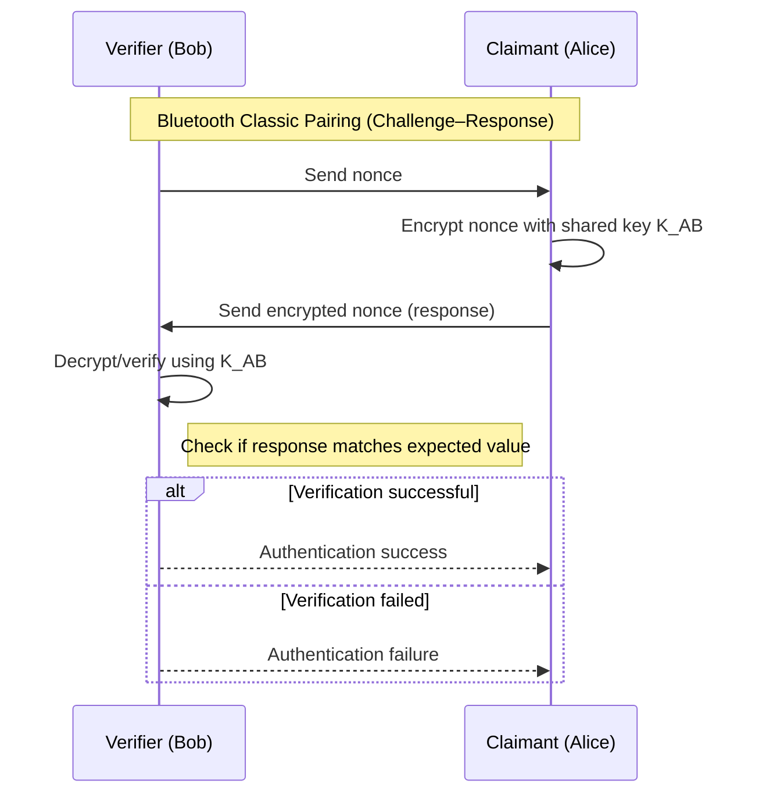

## Cryptographic mechanisms in Bluetooth Classic BR/EDR
**Bluetooth Classic** (_BC_), also referred to as **Basic Rate/Enhanced Data Rate** (_BR/EDR_), uses a set of custom cryptographic algorithms derived from the **Secure And Fast Encryption Routine** (_SAFER+_), a block cipher defined in 1998 with a block size of 128 bits. SAFER+ was submitted as a candidate for the **Advanced Encryption Standard** (_AES_) process but was not selected as a finalist.

Bluetooth uses SAFER+-based custom algorithms for two purposes:

- **Key derivation**: algorithms E21 and E22 derive initialization and link keys from the PIN, the device address, and a random value.
- **Authentication**: algorithm E1 functions as a **message authentication code** (_MAC_) for the challenge-response authentication protocol.

Encryption uses the **E0** stream cipher, derived from the Massey-Rueppel algorithm. E0 is described as open and computationally cheap, which was a design priority for resource-constrained devices.

A notable weakness of BR/EDR is that **there is no cryptographic message integrity**. The protocol uses a **Cyclic Redundancy Check** (_CRC_) for error detection, but a CRC does not provide cryptographic integrity guarantees and can be forged by an attacker who can manipulate the link.

### Authentication protocol: challenge-response with a shared key

The authentication mechanism in Bluetooth Classic is a **challenge-response protocol** based on a shared symmetric key. Its goal is to prove that a device is live (i.e., actively participating in the session) and possesses the correct key, thereby preventing **replay attacks**, in which a recorded response is retransmitted by an attacker.

The protocol works as follows. The verifying device (Bob) sends a random value called a **nonce** to the claimant (Alice). Alice encrypts the nonce using the shared secret key $K_{AB}$ and returns the result. Bob, who knows the same key, can verify that the response is correct. Since only Alice should know $K_{AB}$, a correct response proves Alice's identity.



The fundamental weakness of this scheme when applied to legacy Bluetooth is that if the shared key is derived from a short PIN, an attacker who records the exchange can attempt to recover $K_{AB}$ offline by testing all possible PIN values, computing the expected response for each, and comparing it with the recorded response.

## Legacy pairing: detailed key derivation and encryption setup

The full procedure for legacy pairing establishes a shared **link key** derived from a user-provided PIN. The procedure consists of three steps.

**PIN entry and initialization key derivation.** Both devices use the same PIN (typically 4 digits, often fixed in embedded devices). An initialization key `K_init` is computed as:

```
K_init = E22(PIN, BD_ADDR, RAND)
```

where `BD_ADDR` is the Bluetooth device address of one of the devices, and `RAND` is a random value sent in plaintext over the Bluetooth link as part of the protocol. This plaintext transmission of `RAND` is a design choice that, combined with the low entropy of the PIN, enables offline attacks.

**Link key generation and authentication.** A link key (either a unit key or a combination key) is derived using `K_init`. Authentication then proceeds as a challenge-response: the verifier sends a random challenge `R`, and the responder computes:

```
SRES = E1(K_link, R)
```

The verifier checks that SRES is correct to authenticate the device.

**Encryption setup.** A session key is derived as:

```
K_enc = E3(K_link, RAND)
```

Traffic is then encrypted using the E0 stream cipher with `K_enc`.

### Why legacy pairing is vulnerable to offline attacks

The critical weakness of legacy pairing is that the **entire security of the link key depends on the entropy of the PIN**. Because all inputs to the key derivation function (`PIN`, `BD_ADDR`, `RAND`) are either short and guessable or transmitted in plaintext, an attacker who records the pairing exchange can perform an offline brute-force search over the PIN space.

The only principled solution to this problem is to eliminate the use of a low-entropy PIN as the direct cryptographic secret. This requires replacing the PIN-based key derivation with an **authenticated key exchange** in which the PIN is not used to derive the key directly and in which no deterministic check enables offline validation. This is the approach taken by SSP.

## Secure Simple Pairing: cryptographic design

The core cryptographic improvement introduced by SSP is the use of **Elliptic Curve Diffie-Hellman** (_ECDH_) public key cryptography. Under ECDH, each device generates a public/private key pair. The two devices exchange public keys and independently compute a shared secret using their own private key and the other device's public key. The link key is then derived from this shared secret rather than from the PIN.

This design eliminates offline brute-force attacks on the PIN because the link key is derived from the ECDH shared secret, which depends on solving the **elliptic curve discrete logarithm problem**. An attacker who records the pairing exchange would need to solve this computationally hard problem to derive the link key, which is infeasible with current cryptanalytic techniques.

However, ECDH alone does not authenticate the identity of the peer. It provides **confidentiality** but not **entity authentication**. This leaves SSP vulnerable to **man-in-the-middle** (_MITM_) attacks when unauthenticated association models are used.

### Authentication using public key cryptography
Authentication can also be performed using public key cryptography in a challenge-response protocol. The verifier (Bob) sends a nonce `R` to the claimant (Alice). Alice encrypts `R` using her **private key** $K\_A^-$ and returns the result. Bob, who has Alice's **public key** $K\_A^+$, decrypts the response and verifies that it equals R. Since only Alice holds the private key $K\_A^-$, a correct response proves Alice's identity.

The vulnerability in this scheme is that it does not verify the authenticity of the public key itself. If an attacker can substitute their own public key for Alice's during the key exchange, they can impersonate Alice to Bob and Bob to Alice simultaneously. This is the basis of the MITM attack.

### The MITM attack
A **man-in-the-middle** (_MITM_) attack occurs when two devices attempt to pair but an attacker intercepts the connection. Instead of communicating directly, each device unknowingly establishes a connection with the attacker's device, which relays messages between them and gives the illusion of a direct connection.

In this position, the attacker can:

- **Eavesdrop** on all communication between the two devices.
- **Insert or modify** messages on the connection, corrupting or replacing data in transit.
- **Inject commands** into one or both devices, potentially altering their behavior or damaging their function.

In the context of public key authentication, the attack proceeds as follows. The attacker (Trudy) intercepts Alice's identity claim and presents their own public key $K\_T^+$ to Bob instead of Alice's. Bob authenticates Trudy as Alice because he uses $K\_T^+$ to verify the response. Symmetrically, Trudy obtains Alice's public key $K\_A^+$ and forwards it appropriately. All subsequent communication is encrypted with keys that Trudy controls, so Trudy can decrypt, read, modify, and re-encrypt any message exchanged between Alice and Bob, without either party detecting the interception.

### Protection against MITM attacks: association models
The defense against MITM attacks in SSP is to require both devices to **solve a shared challenge that the attacker cannot observe**. This is accomplished by exchanging an out-of-band secret through a channel that the attacker cannot intercept, or by having the user verify a value displayed on both devices.

SSP provides four association models, introduced in Bluetooth Classic SSP and reused in BLE pairing to provide optional MITM protection:

- **Just Works**: no user interaction is required. The passcode is fixed at 000000. This model provides **no MITM protection** and should only be used when neither device has a display or input capability.
- **Numeric comparison**: both devices independently compute and display the same 6-digit number. The user verifies that the two numbers match and confirms on both devices. This prevents MITM attacks because the attacker would need to guess the correct 6-digit value.
- **Passkey entry**: the user reads a 6-digit passcode displayed on one device and enters it on the other, or enters the same 6-digit passcode on both devices independently. This also prevents MITM attacks.
- **Out-Of-Band** (_OOB_): a separate wireless protocol such as NFC is used to authenticate the pairing. Because the attacker cannot intercept the OOB channel, this prevents MITM attacks.

The probability that an attacker succeeds in an MITM attack against Numeric Comparison or Passkey Entry is $\frac{1}{10^6} \approx 2^{-20}$, since the attacker must correctly guess the 6-digit value to insert their own keys undetected.