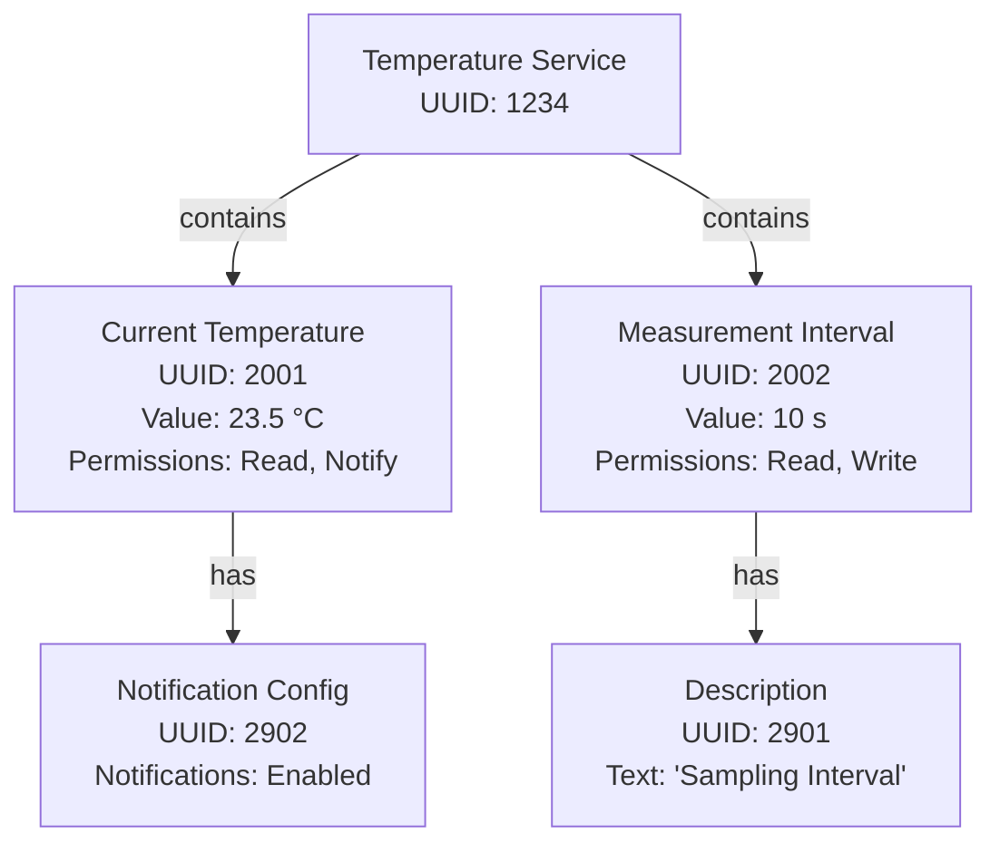
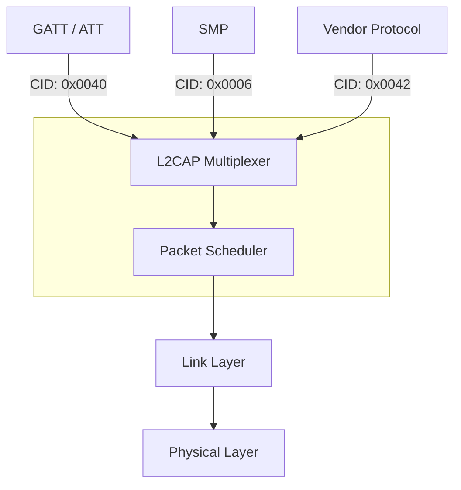

## The host part: top-down approach

### GAP: Generic Access Profile

**GAP** (*Generic Access Profile*) is the topmost control layer in the BLE Host. It defines the roles, operational modes, and procedures that govern how a device presents itself to the outside world and how it interacts with other devices. GAP is responsible for:

- **Device discovery**: making a device visible to others and enabling it to find nearby devices.
- **Link establishment and termination**: initiating and closing connections.
- **Initiation of security features**: triggering pairing, bonding, and encryption setup.
- **Device configuration**: defining the device's operating role and parameters.

GAP provides the communication channel abstraction through which two devices can interact before and during a connection. It is not a data transfer protocol; it is a control and management profile that governs the conditions under which data transfer can take place.

### Device states and the discovery process

A BLE device moves through a defined set of states as it transitions from idle to connected. These states are part of GAP's operational model.

- **Standby** is the initial idle state following a device reset. No radio activity occurs in this state.

- A device in the **Advertiser** state broadcasts advertising packets on the three designated advertising channels. These packets contain the device's address and optional additional data such as the device name or a UUID list. The purpose of advertising is to announce the device's presence and, optionally, its willingness to accept connections.

- A device in the **Scanner** state listens on the advertising channels for packets from advertisers. Scanning operates in two modes. 
	- In **passive scanning**, the scanner simply receives advertising packets without sending anything in return; the advertiser is never made aware that its packet was received. 
	- In **active scanning**, the scanner sends a **SCAN_REQ** packet to the advertiser when it wants more information than the advertising packet contains. The advertiser responds with a **SCAN_RSP** packet carrying supplementary data. Active scanning is typically used when a potential central device needs to evaluate a device more thoroughly before deciding to connect.

- When a scanner finds a device it wants to connect to, it transitions to the **Initiator** state. In this state, the device specifies the address of the target peripheral and issues a connection request, including the connection parameters (such as the desired connection interval and supervision timeout).

- Once the connection is established, the initiating device becomes the **Central** node and the advertising device becomes the **Peripheral** node. From this point, communication moves off the advertising channels and onto the data channels, governed by the Link Layer.

### Advertising in detail

Each advertising event consists of the advertiser transmitting the same packet on all three advertising channels (37, 38, and 39) in rapid succession. There are four types of advertising packets:

- **General** (connectable, undirected): the standard advertising type, allowing any scanner to connect.
- **Directed**: addressed to a specific device, used when the advertiser already knows the central it wants to connect to.
- **Non-connectable**: the device broadcasts data but does not accept connections; used for beacons.
- **Discoverable**: the device accepts scan requests but not connection requests; used when a scan response is required but connection is not.

The **advertising interval** is the time between consecutive advertising events. It can range from a minimum of 20 milliseconds to a maximum of 10.24 seconds. A longer advertising interval reduces the number of transmissions per unit time, directly reducing energy consumption. Applications that are less time-sensitive to discovery can increase this interval substantially to extend battery life.

### GATT: Generic Attribute Profile

**GATT** (*Generic Attribute Profile*) defines how two connected BLE devices exchange application data. It organizes all data into a structured hierarchy of services and characteristics, and it implements a **client-server architecture**. The GATT server holds the data; the GATT client initiates requests to read, write, or subscribe to data on the server.

- The **GATT-Client** initiates commands and requests directed at the server. It receives responses, indications, and notifications in return.
- The **GATT-Server** accepts incoming commands and requests from clients, and sends back responses, indications (which require acknowledgment from the client), and notifications (which do not).

The GATT data model is organized as follows:

- A **service** is a collection of data and associated behaviors used to accomplish a particular function. For example, the Heart Rate Service groups all data related to heart rate measurement.
- A **characteristic** contains the actual value used in a service, along with the permissions that specify what operations (read, write, notify) the client may perform on it.
- A **characteristic descriptor** provides metadata describing the behavior of its associated characteristic. For example, a descriptor can configure whether notifications are enabled for a given characteristic.

### ATT: Attribute Protocol

**ATT** (*Attribute Protocol*) is the protocol that sits beneath GATT and defines how individual units of data are structured and accessed on a GATT server. While GATT defines the logical organization of data (services, characteristics, descriptors), ATT defines the actual on-air data units and the rules for accessing them.

Every piece of data on a server is represented as an **attribute**. Each attribute has four fields:

- A **16-bit attribute handle**: a numerical identifier that uniquely references the attribute within the server's attribute table.
- A **UUID** (*Universally Unique Identifier*): identifies the type of the attribute (e.g., what kind of service or characteristic it represents). Standard types use 16-bit SIG-assigned UUIDs; custom types use 128-bit UUIDs.
- A **value**: the actual data content of the attribute.
- A **set of permissions**: defines the access rights (readable, writable, notifiable, etc.) and whether authentication or encryption is required to access the attribute.

ATT defines the READ and WRITE operations available to the client. A device can function as an ATT client, an ATT server, or both simultaneously.

An important distinction is that **characteristics and attributes are not the same thing**. A characteristic is a GATT-level concept that is implemented as a set of multiple attributes. Specifically, a characteristic is represented by at least two attributes: a declaration attribute (which describes the characteristic's properties and handle) and a value attribute (which holds the data). Descriptors add further attributes. The attributes are the **atomic data units** that are actually exchanged over the air; the characteristic is the logical construct the application works with.

### L2CAP: Logical Link Control and Adaptation Protocol

**L2CAP** (*Logical Link Control and Adaptation Protocol*) sits between the application-facing host protocols (GATT, ATT, SMP) and the Link Layer. It serves four primary functions:

- **Protocol multiplexing**: allows multiple higher-layer protocols to share a single link-layer connection by assigning each a logical channel identifier.
- **Segmentation and reassembly**: breaks large **SDUs** (*Service Data Units*, up to 64 KB) into smaller **PDUs** (*Protocol Data Units*) that fit within link-layer packets, and reassembles them at the receiver.
- **Error detection and retransmission**: supports configurable error recovery modes.
- **Flow control**: prevents a sender from overwhelming a slower receiver.

L2CAP encapsulates data from GATT/ATT and SMP into the standard BLE packet format before passing it down to the Link Layer, according to the link configuration negotiated at the ATT and SMP layers.

### Host-side HCI

The **HCI** (*Host Controller Interface*) is the standardized boundary between the Host and the Controller. On the host side, the HCI handles the interface toward the controller. It defines a set of commands and events: the host issues commands to control the controller (e.g., to set advertising parameters, initiate a connection, or configure encryption), and the controller generates events to notify the host of state changes or received data. The HCI is transport-agnostic and can be implemented over UART, USB, or other physical interfaces.

## Connection setup and service discovery

When a discoverable device is found, a scanner can query the following information before establishing a full connection:

- Device name
- Device class
- List of services
- Supported features and specifications

Devices that are not in a discoverable mode will only respond to direct queries addressed to their known device address. Some services may require **pairing** before they are accessible, which typically requires explicit acceptance by the device owner. Pairing generates a **bond** between two devices, which includes generating shared cryptographic keys used for encryption and authentication in subsequent connections.

### SDP: Service Discovery Protocol (Bluetooth Classic)

In Bluetooth Classic, service discovery is handled by the **SDP** (*Service Discovery Protocol*). SDP allows a device to discover the services offered by a remote device and obtain the parameters required to use them. The protocol operates over an L2CAP connection and consists of multiple phases, each of which is optional depending on what information is already known:

1. **Inquiry and paging** (via the Baseband layer): used when connecting to a previously unknown device.
2. **Name request** (via LMP): retrieves the human-readable device name.
3. **Authentication** (via LMP): performed when security requirements mandate it, including pairing, authentication, and encryption setup.
4. **L2CAP connection**: establishes the SDP channel between the local SDP client and the remote SDP server.
5. **SDP inquiries and responses**: the actual service discovery exchanges, using Search_req/Search_resp and Attribute_req/Attribute_resp messages.
6. **Termination**: the connection is torn down after discovery is complete.

Services in Bluetooth Classic are represented as profiles, each comprising a set of characteristics. SDP's role is to enumerate available profiles and return the parameters needed to use them.

In BLE, the equivalent functionality is provided by GATT service discovery, which is performed after connection establishment on the data channel.
